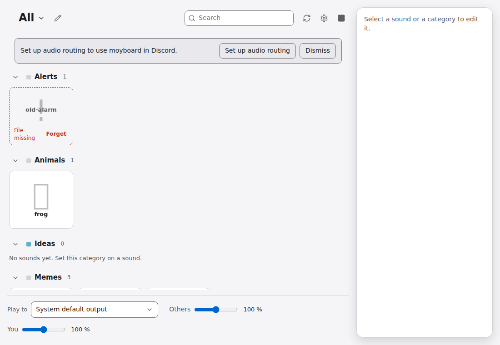
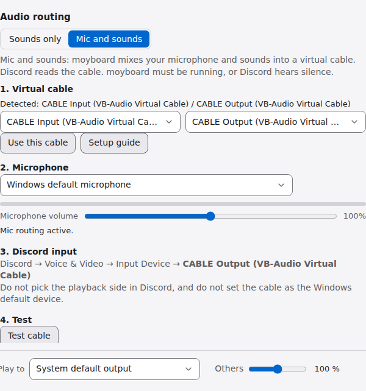

# moyboard – a simple, lightweight soundboard for Windows. Play sounds into Discord, games, and calls.

## Features

- Pads with emoji and colours, grouped by categories, with search
- Drag and drop sounds from Explorer; sounds are copied into `Music\moyboard`
- Trim sounds, set volume per sound, save trimmed copies as WAV
- Hotkeys per sound, a Quick Panel hotkey overlay, and a stop-all hotkey
- Preview: hear a sound on your own headphones ("play to you")
- Runs in the system tray and can start with Windows



## Requirements

- Windows 10 or 11 (x64)
- A virtual audio cable **or** mixer software (see [Setup](#setup))

## Install

1. Download `moyboard_<version>_x64-setup.exe` from the Releases page.
2. Run it. Windows SmartScreen may warn, because the app is not code-signed: choose *More info* → *Run anyway*.

## How it works

moyboard plays sounds into a virtual audio device. Your voice app (Discord, a game) records from the matching virtual input.

```
moyboard ──► virtual output ("CABLE Input") ──► virtual input ("CABLE Output") ──► Discord
```

Two modes, set in *Settings → Audio routing*:

- **Sounds only**: sounds go to the output you choose. Use it when your mixer (Wave Link, VoiceMeeter) already adds your microphone.
- **Mic and sounds**: moyboard captures your microphone, mixes it with the sounds, and plays the mix into the cable. Use it with a plain virtual cable, or when you have none yet. moyboard must be running in this mode.

## Setup

### Option 1: I already have a virtual cable or mixer

Wave Link, VoiceMeeter, VB-CABLE, or similar.

- **Your mixer adds your mic** (Wave Link, VoiceMeeter): in moyboard choose **Sounds only** and pick the mixer's virtual output under *For others*. In Discord, select the input your mixer provides.
- **Plain cable only** (VB-CABLE, Virtual Audio Cable): in moyboard choose **Mic and sounds**, select the cable's playback side and your microphone. In Discord, select the cable's recording side (`CABLE Output`).



### Option 2: I have no virtual cable (mic only)

1. Download VB-CABLE from <https://vb-audio.com/Cable/>. It is donationware: please consider supporting the author.
2. Extract the archive, run the setup as administrator, and restart Windows.
3. In moyboard choose **Settings → Audio routing → Mic and sounds**. Select the cable and your microphone, then press **Test cable**.
4. In Discord, go to *Voice & Video → Input Device* and select **CABLE Output**.

## Daily use

- Add sounds by dragging files onto the window. Click a pad to select it; the Play button plays another instance.
- Assign categories and hotkeys in the sidebar.
- Quick Panel hotkey: open the overlay and play a sound from anywhere. Set it and the hold/toggle mode in Settings.
- Stop-all hotkey: stop every playing sound at once.

## Troubleshooting

- **"No virtual cable found"**: install the cable, restart Windows, then press *Refresh* in Settings.
- **Others can't hear me**: check that Discord's input is the cable's recording side, and that moyboard is running.
- **Echo or feedback**: do not set the cable as the Windows default playback or recording device, and do not choose its playback side in Discord.
- **Mic silent when moyboard is closed** (Mic and sounds): enable *Start with Windows* and *Close to tray* in Settings.
- **"Microphone not found" or access denied**: choose the microphone again in Settings, or open the microphone privacy settings from the same section and allow desktop apps.

## Build from source

Developed in WSL, built as a Windows installer.

Prerequisites: rustup with the `x86_64-pc-windows-msvc` target, `cargo-xwin`, `nsis`, `lld`, `llvm`, `clang`, Node 22+.

```bash
npm install
npm run tauri build -- --runner cargo-xwin --target x86_64-pc-windows-msvc --bundles nsis
```

Output: `src-tauri/target/x86_64-pc-windows-msvc/release/bundle/nsis/moyboard_<version>_x64-setup.exe`.

Tests: `cargo test --manifest-path src-tauri/crates/moyboard-core/Cargo.toml` and `npm run test:e2e`.

## License and credits

moyboard is released under the license in [LICENSE](LICENSE) (to be added). It uses [Tauri](https://tauri.app), [rodio](https://github.com/RustAudio/rodio), [cpal](https://github.com/RustAudio/cpal) and [VB-CABLE](https://vb-audio.com/Cable/) by VB-Audio, which is a separate download and not included.
